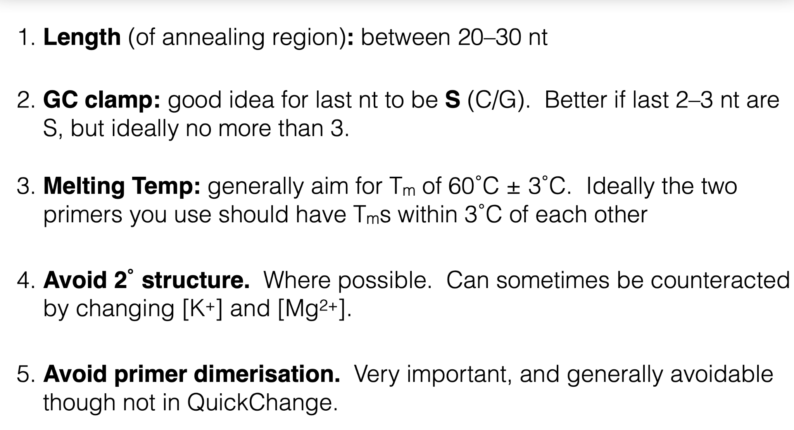

# Primer guide

Length corresponds to the anneal region (obviously these can be a lot longer if you have 5’ overhangs)

For the GC clamp.  Absolutely necessary for the last nt to be S.  Optimal if the last 2-3 nt are S, though this is not always possible.  A relaxed version (which is oftentimes possible) is to have 2-3 S nt amongst the 5 last nt.  It is oftentimes not advisable to have all 5 of the last 5 nt to be S.

For melting temp, I use the SnapGene calculator, which tends to be on the conservative side.

As for secondary structure, it can often be hard to avoid depending on what exactly you want to do.
