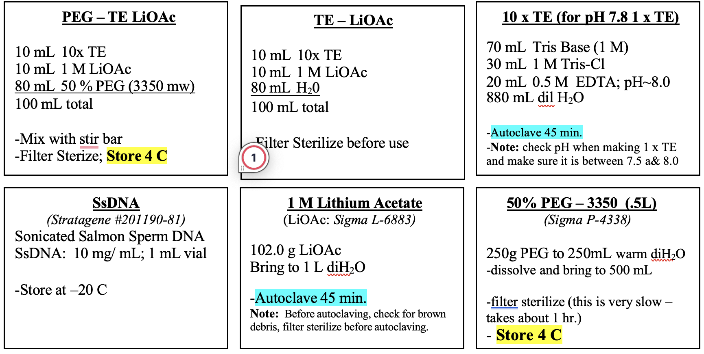

# Yeast transformation

1. Grow yeast cells to saturated phase in 5 mL auxotrophic media (SCC) overnight, at 30 ºC/220 RPM, in 14 mL RB falcon tubes.
2. Day culture to log phase (0.6-0.8 OD) at 30 ºC/220 RPM with a starting OD of 0.05.
3. Harvest (5 min, 3000 *g*) after transferring to a 15 mL conical tube; aspirate supernatant (sterile tip).
4. Wash cell pellet 1x with 1 mL TE-LiOAc; transfer to Eppendorf tubes. Spin down again (5 min, 3000 *g*).
5. Resuspend in 100 μL of TE-LiOAc. Add 10 µL freshly boiled (95 ºC, 700 RPM for 5-10 min) salmon sperm DNA (10 mg/mL). Further, add 1 µL of plasmid (~100 ng) or all of the PCR  product and  800 µL of PEG-TE-LiOAc (PEG: cryoprotectant).
6. Incubate @ 30 ºC at 200 rpm; 30 min. Heat Shock 42 ºC; 40 min (between 20 mins and 2 h is fine).
7. Harvest cells (5 min, ~ 3000 *g*), and remove supernatant.
8. Wash pellet 1x with 1 mL of H2O.
9. Resuspend in 100 μL of H2O. Plate onto a selective medium (For pESC–Leu2D plasmid, the plate is SD–Leu (1:1 of 2x SD–Leu and 2x Agar).

   > *NOTE: Set up a Bunsen burner to maintain the sterile field throughout all steps.*

10. Incubate plates 2 days @ 30º C and can take up to 4 days.

### Solution Details

